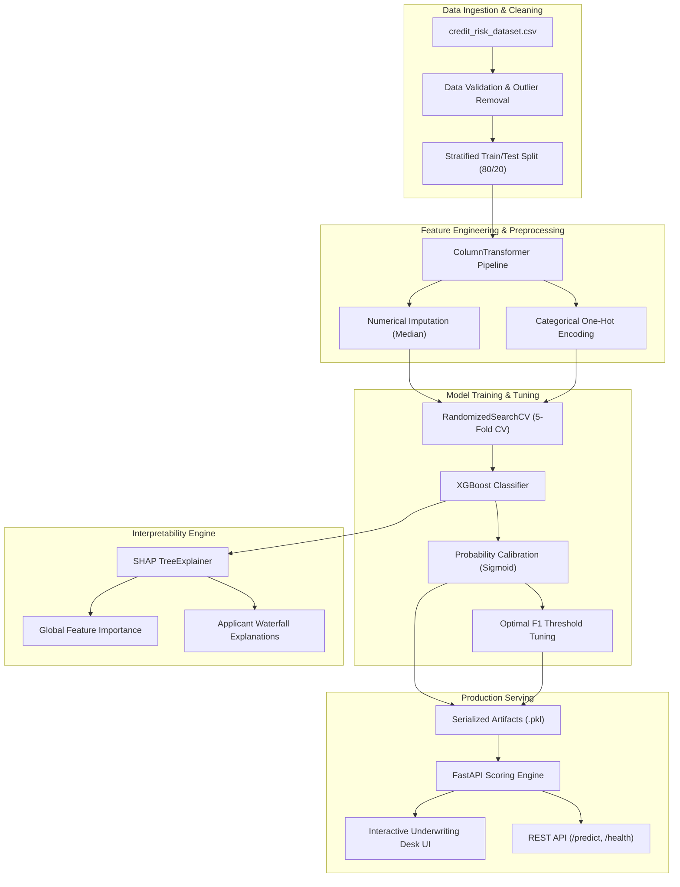

# Credit Ledger — Explainable Credit Risk Assessment & Underwriting Desk

[](https://www.python.org/)
[](https://fastapi.tiangolo.com/)
[](https://xgboost.ai/)
[](https://shap.readthedocs.io/)
[](LICENSE)

An end-to-end, production-ready machine learning underwriting system and explainable credit scoring service. Built using **XGBoost**, **SHAP (SHapley Additive exPlanations)**, **Scikit-Learn Pipelines**, and **FastAPI**, this project predicts borrower default probabilities while providing transparent, compliant decision attributions for modern retail lending.

---

## Table of Contents
- [Overview](#overview)
- [System Architecture](#system-architecture)
- [Machine Learning Workflow](#machine-learning-workflow)
- [Model Performance Benchmark](#model-performance-benchmark)
- [Explainability & SHAP Insights](#explainability--shap-insights)
- [API & Underwriting Interface](#api--underwriting-interface)
- [Project Structure](#project-structure)
- [Quickstart Guide](#quickstart-guide)
- [API Reference](#api-reference)
- [Deployment](#deployment)
- [License](#license)

---

## Overview

Traditional credit scoring models often face a trade-off: interpretable linear models lack nonlinear predictive power, while complex ensembles function as black boxes. In regulated lending environments (governed by frameworks such as the Fair Credit Reporting Act and GDPR), adverse action notices require explainability for any credit denial.

This project delivers:
- **Calibrated Default Predictions**: Estimating true risk probability rather than uncalibrated confidence scores.
- **Decision Threshold Optimization**: Precision-Recall boundary tuning to maximize F1 score and minimize costly False Negatives.
- **Compliant Explainability**: Global feature importance and individual loan waterfall plots with SHAP.
- **Production Underwriting API**: High-throughput FastAPI service with full Pydantic data validation and an interactive frontend underwriting desk.

---

## System Architecture



---

## Machine Learning Workflow

The end-to-end data science lifecycle is contained in the clean, executable notebook [`Credit_Risk.ipynb`](file:///d:/thetis%20trading%20bot/cognitive%20platform/Credit-Risk-Assesment-using-SHAP/Credit_Risk.ipynb):

1. **Data Ingestion & Integrity Auditing**:
   - Filter age entry errors ($18 \le \text{age} \le 100$).
   - Remove tenure anomalies ($\text{employment length} < \text{age}$ and $\le 60\text{ years}$).
   - Enforce positive income and loan principal constraints.
   - Eliminate duplicated applicant records.

2. **Dual-Model Pipeline Architecture**:
   - **Logistic Regression Preprocessor**: Median imputation followed by `StandardScaler` for numeric columns, alongside `OneHotEncoder` for categoricals.
   - **XGBoost Preprocessor**: Scale-invariant median imputation and categorical one-hot encoding without artificial monotonic transformations.

3. **Handling Class Imbalance**:
   - Calculates dynamic `scale_pos_weight` ($\frac{\text{Non-Defaults}}{\text{Defaults}}$) directly from the training split to avoid majority-class bias.

4. **Hyperparameter Optimization**:
   - 5-fold Stratified Cross-Validation using `RandomizedSearchCV` across `n_estimators`, `max_depth`, `learning_rate`, `subsample`, `colsample_bytree`, and regularization `gamma`.

5. **Decision Threshold Optimization**:
   - Replaces the naive 0.5 threshold by evaluating Precision-Recall curves to identify the operating point that maximizes the harmonic mean ($F_1$ score).

6. **Probability Calibration**:
   - Diagnoses model reliability using calibration curves and applies Platt scaling (`CalibratedClassifierCV`) so predicted scores reflect empirical default frequencies.

7. **Explainability with SHAP (SHapley Additive exPlanations)**:
   - Computes global Shapley values across test observations.
   - Generates local waterfall plots identifying the specific drivers pushing individual applications into High vs. Low risk categories.

---

## Model Performance Benchmark

Both models were cross-validated and tested on an identical unseen stratified holdout split:

| Model | Preprocessing | Accuracy | Precision | Recall | F1 Score |
| :--- | :--- | :---: | :---: | :---: | :---: |
| **Logistic Regression (Baseline)** | Imputation + StandardScaler + OHE | 0.82 | 0.56 | 0.79 | 0.65 |
| **XGBoost (Tuned & Calibrated)** | Imputation + OHE + ScalePosWeight | **0.92** | **0.81** | **0.81** | **0.81** |

### Key Observations:
- **Precision Surge**: XGBoost improved precision from **0.56 to 0.81**, drastically reducing false alarms (credit-worthy borrowers erroneously flagged as high risk).
- **Default Capture Rate**: Maintained a strong **81% recall** on actual defaulters while preserving high overall accuracy (**92%**).

---

## Explainability & SHAP Insights

Using `shap.TreeExplainer`, each feature's marginal contribution is quantified:

1. **Loan-to-Income Ratio (`loan_percent_income`)**: Strongest positive predictor of default; debt burdens exceeding ~25-30% of income drastically elevate risk.
2. **Prior Default History (`cb_person_default_on_file`)**: Historical defaults heavily increase baseline log-odds of default.
3. **Assigned Loan Grade (`loan_grade`)**: Lower credit grades (D, E, F) exhibit pronounced positive Shapley attribution toward default.
4. **Loan Interest Rate (`loan_int_rate`)**: Higher interest structures correlate with higher default rates, reflecting underlying borrower credit risk.

---

## API & Underwriting Interface

The repository includes a web underwriting console connected to the FastAPI scoring engine:

- **Clean Ledger Interface**: Enter applicant age, income, loan purpose, grade, credit bureau flags, and tenure.
- **Dynamic Risk Gauge**: Visual indicator showing calibrated probability of default versus the decision threshold.
- **Underwriting Stamp**: Official verdict badge (`LOW RISK` or `HIGH RISK`).

---

## Project Structure

```
Credit-Risk-Assesment-using-SHAP/
├── static/
│   ├── index.html              # Underwriting desk frontend interface
│   ├── script.js               # Client-side validation, gauge animations, and API client
│   └── style.css               # Clean typography and responsive design system
├── Credit_Risk.ipynb           # Complete ML research, modeling, calibration & SHAP notebook
├── credit_risk_dataset.csv     # Historical consumer credit and default dataset
├── credit_risk_model.pkl       # Serialized production pipeline (Calibrated XGBoost)
├── best_threshold.pkl          # Serialized optimal classification cutoff
├── main.py                     # FastAPI application serving REST endpoints and static UI
├── render.yaml                 # Deployment configuration for cloud hosting (Render)
├── requirements.txt            # Pinned dependencies
├── runtime.txt                 # Targeted Python runtime
├── .gitignore                  # Git ignore rules for Python, notebooks, and OS artifacts
└── README.md                   # Project documentation
```

---

## Quickstart Guide

### Prerequisites
- Python **3.10**, **3.11**, or **3.12**
- Git

### 1. Clone & Navigate
```bash
git clone https://github.com/ishanmane0/Credit-Risk-Assessment-using-SHAP.git
cd Credit-Risk-Assessment-using-SHAP
```

### 2. Set Up Virtual Environment
```bash
# macOS/Linux
python3 -m venv venv
source venv/bin/activate

# Windows (PowerShell)
python -m venv venv
.\venv\Scripts\Activate.ps1
```

### 3. Install Dependencies
```bash
pip install --upgrade pip
pip install -r requirements.txt
```

### 4. Run the Underwriting Service
```bash
uvicorn main:app --reload --host 0.0.0.0 --port 8000
```
- Open **`http://localhost:8000`** in your browser to access the Underwriting Desk UI.
- Open **`http://localhost:8000/docs`** to explore the interactive Swagger API documentation.

### 5. Run the Research Notebook
```bash
jupyter notebook Credit_Risk.ipynb
```

---

## API Reference

### Health Check
`GET /health`

**Response:**
```json
{
  "status": "healthy",
  "model_loaded": true,
  "decision_threshold": 0.6952
}
```

---

### Predict Loan Default Risk
`POST /predict`

**Request Body:**
```json
{
  "person_age": 30,
  "person_income": 600000.0,
  "person_home_ownership": "RENT",
  "person_emp_length": 5.0,
  "loan_intent": "PERSONAL",
  "loan_grade": "B",
  "loan_amnt": 100000.0,
  "loan_int_rate": 11.5,
  "loan_percent_income": 0.17,
  "cb_person_default_on_file": "N",
  "cb_person_cred_hist_length": 6
}
```

**Response:**
```json
{
  "default_probability": 0.1245,
  "default_prediction": 0,
  "threshold": 0.6952,
  "Result": "Low Risk"
}
```

---

## Deployment

The project contains a pre-configured [`render.yaml`](file:///d:/thetis%20trading%20bot/cognitive%20platform/Credit-Risk-Assesment-using-SHAP/render.yaml) file for one-click deployment on Render:

```yaml
services:
  - type: web
    name: credit-ledger
    runtime: python
    plan: free
    buildCommand: pip install -r requirements.txt
    startCommand: uvicorn main:app --host 0.0.0.0 --port $PORT
    autoDeploy: true
```

---

## License

This project is licensed under the MIT License.
